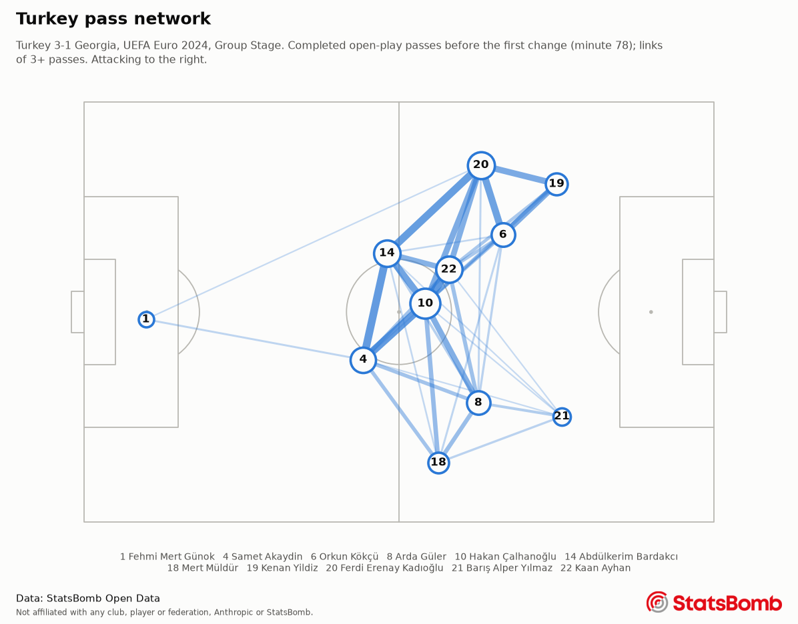
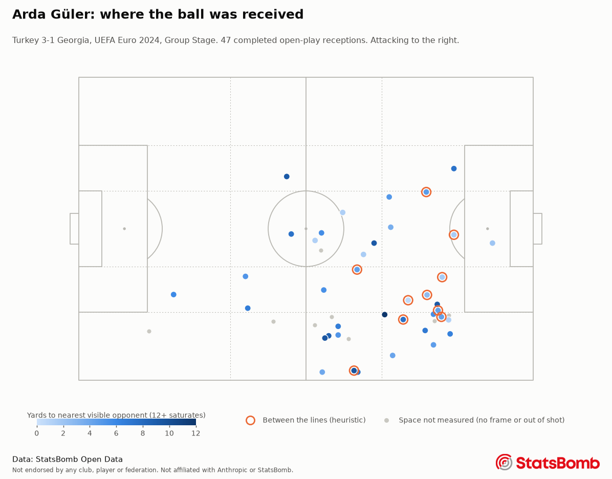

# Agentic Touchline


A football match-analysis agent on Claude. Given a match's data, it writes a player and team report
with pitch charts. A player can then ask, in Turkish, Spanish or English, about their role
and where they should receive the ball. Every number in an answer comes from a query the agent ran.

Data: [StatsBomb Open Data](https://github.com/statsbomb/open-data). Analysis here is not
necessarily the opinion of StatsBomb.

Not endorsed by any club, player or federation. Not affiliated with Anthropic or StatsBomb. Built only on public data; no private data from any client work is used.

## Status

| Part | State |
| --- | --- |
| Ingest, metrics, charts | Real, and run on the public data |
| Deterministic checks (number faithfulness, boundary routing) | Real, and run |
| Agent loop, analyst, coach, approval gate | Real code, tested against a scripted client and a fake HTTP transport |
| Live-agent transcripts | **Not yet run** |
| Live-agent evals | **Not yet run** |

There was no API key where this was built, so no request has reached Claude. No prompt has been
seen working against the model, and no cache hit or refusal has been observed. This README has no
sample conversation because there is no recorded one to show.

## The problem

A language model will write a confident sentence about a player's 47 receptions whether or not the
47 is true. In a report that a player acts on, a plausible wrong number is the worst failure, and
a reader can't see it by looking.

So the system splits the work. Code computes every number, with a stated definition. The model
chooses which numbers matter and explains them in the player's language. A deterministic check
then compares each number in the text with the tool results of that conversation. The check is
independent of the model, so it can be tested offline, and it is the part this repository can
demonstrate today.

## Architecture

```
StatsBomb Open Data (GitHub, fetched to a gitignored cache, never committed)
        |
        |  touchline ingest: typed schemas, then integrity checks that fail the run
        v
     DuckDB  matches, lineups, player_minutes, events, frames, frame_players, receptions
        |
        +--> metrics/   SQL and pure Python. Definitions live in one registry.
        |       |
        |       +--> charts.py   PNG, with the StatsBomb logo and credit on each
        |       |
        |       +--> tools.py    9 read-only tools with strict schemas. No SQL from the model.
        |                 |      Every call goes in a ledger.
        |                 v
        |       +--------------------+        +------------------------------+
        |       |   match analyst    |        |        tactical coach        |
        |       |  structured report |        | routing first, no model call |
        |       +--------------------+        | for medical/contract/transfer|
        |                 |                   +------------------------------+
        |                 v                                  |
        |       faithfulness check over the ledger  <--------+
        |                 |                                  |
        |      fail: one repair, then blocked      fail: one repair, then withheld
        |                 v                                  v
        |       draft -> human approval -> report.md       answer to the player
```

## Quickstart

Python 3.11 or later. Only 3.12 has been run locally; CI is configured for 3.11 and 3.12 but has not
run, because the repository has no remote yet.

```console
$ python3.12 -m venv .venv && source .venv/bin/activate
$ pip install -e ".[dev]"
$ touchline ingest     # about 100 seconds on a cold cache here
Ingested 5 matches, 17708 events, 14928 360 frames, 4184 completed receptions into data/touchline.duckdb.
Data: StatsBomb Open Data. Not endorsed by any club, player or federation. Not affiliated with Anthropic or StatsBomb.
  3938639  2024-06-18  Turkey 3-1 Georgia
  3930174  2024-06-22  Turkey 0-3 Portugal
  3930184  2024-06-26  Czech Republic 1-2 Turkey
  3941022  2024-07-02  Austria 1-2 Turkey
  3942382  2024-07-06  Netherlands 2-1 Turkey
```

Without an API key, `--metrics-only` computes and charts everything. This is real output:

```console
$ touchline report --match 3938639 --player "Arda Güler" --metrics-only
| Metric | Value |
| --- | --- |
| Match | Turkey 3-1 Georgia |
| Minutes | 79.3 |
| Positions | Right Wing, Center Forward |
| Shots / goals / xG | 1 / 1 / 0.02 |
| Passes completed / attempted | 41 / 46 |
| Progressive passes | 2 |
| Progressive carries | 3 |
| Pressures | 7 |
| Open-play receptions | 47 |
| Median space at reception, yards | 5.1 (39 measured, 6 censored) |
| Receptions between the lines | 10 of 43 assessable |

Role group: winger, 46.1 minutes in it. Peers in the ingested data: 11. Counts are per 90 in this role.
| Metric | Player | Peer median | Rank | Peers measured |
| --- | --- | --- | --- | --- |
| shots | 0.0 | 1.87 | 9 | 11 |
| xg | 0.0 | 0.08 | 9 | 11 |
| passes_completed | 60.5 | 23.5 | 1 | 11 |
| progressive_passes | 1.95 | 2.09 | 8 | 11 |
| progressive_carries | 1.95 | 5.22 | 11 | 11 |
| pressures | 3.9 | 13.37 | 12 | 11 |
| shot_assists | 3.9 | 1.39 | 1 | 11 |
| median_space_yards | 5.4 | 4.5 | 3 | 11 |
| between_lines_pct | 24.1 | 24.0 | 6 | 11 |

Top reception zones of 47 open-play receptions:
| Zone | Receptions | Share % | Median space | Peer share % |
| --- | --- | --- | --- | --- |
| middle_third:right_wing | 11 | 23.4 | 7.7 | 15.8 |
| final_third:right_wing | 11 | 23.4 | 5.5 | 15.5 |
| middle_third:centre | 7 | 14.9 | 3.5 | 4.1 |
| final_third:centre | 5 | 10.6 | 3.5 | 4.6 |
| final_third:right_half_space | 5 | 10.6 | 2.6 | 3.6 |

Charts in reports/3938639-arda-guler/charts.
Data: StatsBomb Open Data. Not endorsed by any club, player or federation. Not affiliated with Anthropic or StatsBomb.
```

The role table counts only events and minutes in the role group, which is why the shot above does
not appear in it: it came while the data had him at Center Forward. Peers come from these five
matches only.

The same command works for anyone in the data. Arda Güler and more, same match, from real runs:

| Player | Minutes | Passes completed / attempted | Progressive passes | Median space at reception, yards | Between the lines |
| --- | --- | --- | --- | --- | --- |
| Arda Güler | 79.3 | 41 / 46 | 2 | 5.1 | 10 of 43 |
| Ferdi Erenay Kadıoğlu | 98.9 | 74 / 82 | 4 | 6.2 | 5 of 57 |
| Barış Alper Yılmaz | 98.8 | 12 / 18 | 3 | 3.2 | 6 of 17 |





With a key:

```console
$ export ANTHROPIC_API_KEY=...
$ touchline report --match 3938639 --player "Arda Güler"     # writes a draft; releases nothing
$ touchline approve reports/3938639-arda-guler/draft.json --by "Your Name"
$ touchline chat --player "Arda Güler" --match 3938639
```

Those commands have not been run against the API. Without a key they stop cleanly:

```console
$ touchline report --match 3938639 --player "Arda Güler"
No Claude API credentials found. Set ANTHROPIC_API_KEY. Metrics and charts work without one: try `touchline report --match <id> --player <name> --metrics-only`.
[exit code 2]
```

An out-of-scope question never reaches the model, so this works with no key:

```console
$ touchline chat --player "Arda Güler" --ask "Dizim ağrıyor, yarın oynayabilir miyim?"
Coach for Arda Güler. Data: StatsBomb Open Data. Ctrl-D to leave.
Sağlık konularında yardımcı olamam. Lütfen takım doktoru veya fizyoterapistle görüş. Rolün ve topu nerede aldığın konusunda yardımcı olabilirim.
```

Run the checks:

```console
$ pytest                # 287 passed, 16 deselected
$ pytest -m network     # 13 passed, 290 deselected
$ touchline check-boundary
{"total": 30, "failed": 0, "by_route": {"coaching": 11, "medical": 7, "contract": 6, "transfer": 6}}
```

`pytest -m live` holds a three-language smoke test against the API. It has never been run.

## Metrics

Full definitions and limitations are in [docs/metrics.md](docs/metrics.md), generated from the same
registry that feeds the system prompt and the `get_metric_definition` tool, so a test fails if they
drift apart.

| Metric | Short definition |
| --- | --- |
| Minutes | Walked through Starting XI, Tactical Shift, Substitution and sending-off events |
| Shots, xG | StatsBomb's own `statsbomb_xg`, summed. Shootouts excluded |
| Passes | Completed means no outcome field, as StatsBomb encodes it. Open play excludes restarts |
| Progressive passes and carries | End point at least 25% and 5 yards closer to goal centre |
| Pressures | StatsBomb's pressure events, by third |
| Pass network | Completed open-play passes before the first substitution or sending-off |
| Space at reception | Yards to the nearest visible opponent, dropped when an opponent could be out of shot |
| Receptions between the lines | A local heuristic on 360 frames, with a reported denominator |
| Reception zones | 15 zones from thirds and pitch markings |
| Role comparison | Per-90 against peers in the same role group |

The tests check metrics against an invented match, each value worked out by hand. On real data, the
network tests assert that goals plus own goals equal the score in all five matches, and that team
minutes come to eleven players for the match length, including in an extra-time match and a shootout.

Neither heuristic has been validated against human labels. As a sanity check, they should separate
roles the way football says they should, and on these five matches they do
(`python scripts/role_sanity.py`):

| Role | Between the lines | Assessable | Rate % | Median space, yards | Measured |
| --- | --- | --- | --- | --- | --- |
| centre_back | 7 | 697 | 1.0 | 8.2 | 226 |
| defensive_midfield | 84 | 731 | 11.5 | 6.1 | 642 |
| winger | 115 | 426 | 27.0 | 4.5 | 397 |
| striker | 69 | 217 | 31.8 | 3.4 | 232 |

On all 51 matches the order holds: 1.1%, 13.2%, 28.8% and 43.9% between the lines, and 8.1, 5.8, 4.4
and 2.9 yards of median space.

Censoring is uneven: the camera follows the ball, so centre backs lose the most frames. Their
median is the least reliable in this table, and it understates their space.

## What the real data changed

Each of these was found by running on real matches, and each is now handled and tested.

- **Incomplete receipts have misaligned frames.** The 360 specification says frames share the
  event's orientation. On these matches all 3,721 frames of completed receptions place the actor
  within 5 yards of the event, but 528 of 562 frames of incomplete receipts do not, and 295 of those
  sit at the mirrored point. Ingest drops incomplete receipts. The frame checks stay as guards, and
  reject 3 further frames with a goalkeeper in the wrong half (24 across all 51 matches).
- **Lineup stints are not a reliable clock.** The lineup files order position stints by clock, not
  period, so they scramble in extra time: England's player-minutes against Slovakia summed to 1,760.9
  in a match worth 1,467.2. They can also keep a player on after a sending-off. One Czech Republic
  player received a second yellow at 19:17, but a stint from 21:17 to the final whistle gave him
  about 99 minutes, and a Tactical Shift event lists him too. Minutes now come from the event stream,
  a player sent off stays off, and ingest fails if a player or team has more minutes than the match
  allows. Across all 51 matches, 99 of 102 team totals are within 0.2 minutes of 11 x the match
  length, and the other 3 are teams with a sending-off.
- **"Player Off" does not mean the team changed.** It also marks treatment on the touchline.
  Treating it as a change ended the first pass-network window at minute 76, not the substitution at
  minute 78.
- **Space is often unknowable.** 1,285 of 3,718 usable frames are censored, because the nearest
  visible opponent is far enough away that a closer one could be out of shot. Reporting those
  distances as space would have looked more complete and been wrong.

## How it uses Claude

Both agents use the official `anthropic` SDK and the Messages API, in `src/touchline/agents`.

- **Model and parameters.** `claude-opus-5-5`, adaptive thinking, explicit effort (`high` for the
  analyst, `medium` for the coach). No `budget_tokens`, sampling parameters or prefill.
- **Tools.** Nine strict tools with `tool_choice` auto. Schemas are generated from the same Pydantic
  models that validate the input again at runtime. Auto does not guarantee a call, so both agents
  check that evidence exists and ask once more if it does not.
- **Loop.** A manual loop, not the beta tool runner, because the ledger and the stop-reason handling
  sit at that seam. `refusal`, `max_tokens`, `pause_turn` and `model_context_window_exceeded` each
  have a path, and an unknown stop reason counts as incomplete rather than as an answer.
- **Caching.** Tool order and system text are byte-stable, with an explicit breakpoint on the system
  block and automatic caching for the conversation tail. Per-player facts go in the first user turn,
  so the prefix is shared across players. A test pins this. Real hit rates are unknown until a live
  run; the CLI prints cache token counts for that run.
- **Structured output.** The report uses `output_config.format`, and code adds ids and the metric
  table so the model cannot mistype them.
- **Injectable client.** Tests use a scripted client built from the SDK's own response types, plus
  one test that drives the real SDK over a fake HTTP transport to pin the wire format.

## Deterministic checks

**Number faithfulness** (`checks/faithfulness.py`). Each number in a text must match a number in the
conversation's tool results. It handles `1,5`, `%12`, `12 %`, `1.234`, `3-1`, spelled-out numbers in
all three languages, and rounding within the precision written. Tool arguments, error outputs and
digits inside other strings, such as parts of a date, do not count as evidence.

It proves provenance, not meaning. "12 shots" passes if a 12 appears anywhere in the evidence, even
as a count of passes. It also fails closed, so a harmless unmatched number blocks the text.

**Boundary routing** (`checks/routing.py`, 30 questions in `checks/boundary_cases.py`). Keyword rules
send medical, contract and transfer questions to staff with no model call. The set includes traps
such as "injury time", "transferring the ball" and the Turkish "dizilim" next to "dizim". All 30
pass, but the set was used to tune the rules, so that is a regression floor, not an accuracy figure.
Paraphrases get through: `tests/test_routing.py` pins "I took a knock on Sunday and can't run
properly" as a known miss. The second layer is the system prompt, and it has not been measured.

## Limitations

- The live agents have never run. Report quality, the tone of the three languages, whether the
  prompts work and how often the repair path fires are all unknown.
- This has not been used by or tested with any player, coach or analyst.
- Five matches of one team and its opponents make a small, unrepresentative peer pool. `touchline
  ingest --all-matches` takes all 51 matches and passes the integrity checks (187,924 events, 164,530
  frames), but the figures in this README use the five.
- Space and between-the-lines rest on positions estimated from broadcast video, with no player
  identity beyond the actor. Between-the-lines thresholds are judgement calls.
- Reception zones show where a player received the ball, not where they were free and were not found.
  So any advice on where to receive is a hypothesis for the staff, and the prompts say so.
- Role groups come from StatsBomb's position labels, not from how someone actually played.
- The Turkish and Spanish text in the templates and rules has not had a native-speaker review.

## Not done

- Live transcripts and evals.
- A held-out routing set, and any measurement of the model's own boundary behaviour.
- Attribution checking: tying each number to the metric it claims to be.
- Ingesting new matches automatically as they arrive. Ingest is a command, and it rebuilds the
  database.
- Chat persistence, authentication, or any serving layer.

## Data and licence

The code is MIT licensed. **The data is not.** StatsBomb's
[User Agreement](https://github.com/statsbomb/open-data/blob/master/LICENSE.pdf) governs it, and
anyone running this code enters that agreement themselves. No StatsBomb data is in this repository,
test fixtures are invented, and a test fails if a data file is tracked. The agreement also rules out
commercial use of the data or derived analysis, and asks users to register at
<https://statsbomb.com/resource-centre>. [NOTICE.md](NOTICE.md) maps each clause to what the code
does, and notes one open question: the live agent sends derived figures to the Anthropic API, and
whoever runs it should decide whether that fits clause 1.2.1.

The StatsBomb logo appears here and on every chart because the agreement requires it. It remains
StatsBomb's trademark and is outside the MIT license.

The default demo is UEFA Euro 2024 (competition 55, season 282), Türkiye's five matches. The data
spells the team "Turkey", so commands and charts do too. Player names appear as they do in the
public data, and no endorsement by any player, club or federation is implied. No club or federation
logos are used.
